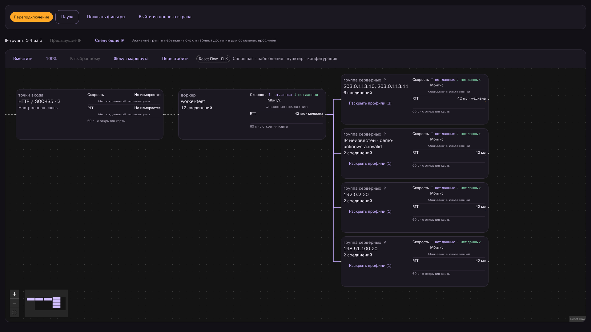

# RelayWeave

**English** | [Русский](README.ru.md)

**Your routes. In harmony.**

A self-hosted proxy platform for a home network and containers. Aggregate
subscriptions, run isolated Xray versions and distribute new connections across
healthy paths, preferring distinct server IPs over a shared upstream balancer.



## Features

- Separate Go control plane, workers and React/Material UI frontend; Docker Compose deployment.
- HTTP proxy and SOCKS5 TCP/UDP listeners, with optional per-listener authentication.
- One administrator, password from environment, no username.
- Multiple subscription sources, aggregate views, profile pools and routing policies.
- Built-in Xray26.10.17, additional approved versions/builds downloaded on demand;
  engine versions can coexist. Other engines can be added through the adapter interface.
- Health checks, bounded retries/backoff, last-good recovery and draining of existing sessions.
- IP-diversity preference: overlapping observed server-IP sets form a shared group.
- [Proxy + ISP paths](docs/dualwan.md): source-bound Xray routes, weighted lane
  selection and disabled-path fencing; requires strict host/router routing.
- React Flow traffic map, browser-side ELK layout, profile expansion and recorded
  selection reasons. Wide compact cards include speed/RTT history, fullscreen and collapsible filters.
- Prometheus metrics, structured logs, optional Loki and dashboards for an external Grafana.
- Client-access export for Throne and similar clients, with scoped/revocable subscriptions.

## Quick start

Requires Linux Docker Engine and Docker Compose. Build on a machine with adequate
CPU, memory and disk; runtime images support amd64 and arm64.

```sh
git clone https://github.com/nd4y/relayweave.git
cd relayweave
cp .env.example .env
chmod 600 .env
# Set independent random ADMIN_PASSWORD and DATABASE_PASSWORD.
# Use URL-safe letters/digits for DATABASE_PASSWORD.
docker compose config --quiet
docker compose build
docker compose up -d --wait --wait-timeout 600
```

Open `http://127.0.0.1:18443`, enter ADMIN_PASSWORD, add subscriptions, create pools,
policies and listeners, then review Plan and Apply. A fresh installation has no
configured upstream subscriptions. The public Compose file uses bridge networking.
Bind to a reachable private LAN/VPN address only when remote clients are needed.

| Endpoint | Default port |
| --- | --- |
| UI/API | 18443/TCP |
| HTTP | 18080/TCP,18081/TCP |
| SOCKS5 | 11080/TCP,11081/TCP |
| SOCKS5 UDP relay | 31000-31255/UDP |

Host and container ports match. Set BIND_IP and PROXY_ADVERTISE_IP together for
LAN/VPN access; keep firewall rules limited to trusted clients. HTTP carries TCP.
SOCKS5 UDP requires UDP ASSOCIATE support; fragmented SOCKS datagrams are rejected.
For HTTPS UI, put a reverse proxy in front and set COOKIE_SECURE=true.

## Monitoring

Grafana is not bundled as a service. Import dashboards from
`observability/grafana/dashboards` into your Grafana and connect its Prometheus
source. Set GRAFANA_URL before building the frontend to enable its dashboard link.
Optional local Prometheus/Loki can be started with:

```sh
docker compose --profile observability up -d
```

If using that Loki, set LOKI_URL=http://loki:3100/loki/api/v1/push in .env and
recreate control-plane/worker. Logs remain available through Docker without Loki.

## What the platform does and does not promise

Balancing applies to new connections. An existing TCP stream stays on its path;
this does not bond a single stream across proxies or home ISPs. Shared server IP
is a conservative capacity hint, not proof of an exit IP or independent bandwidth.
Host networking is deployment-specific and is not inherently faster.

Map speed comes from byte-counter deltas. Its RTT plot is the runtime adapter's
smoothed connection-opening estimate and may reflect a local stage, not end-to-end
site latency. Card history is bounded to the latest60seconds while the map is open.
Missing measurements and counter resets are shown as gaps, never invented zeros.
Client identity, applications and encrypted HTTPS request contents are not inferred.

This is an actively developed prototype. Review [security scope](docs/security.md)
and [validation](docs/validation.md); do not expose an unauthenticated proxy publicly.
Kubernetes/Helm and single-stream multipath are outside this release.

## Development

Go1.27.2 and Node26 are pinned in Dockerfiles; dependency lockfiles and upstream
artifact SHA-256 values are committed. Use `tools/check-buildhost.sh` on your build
host for source tests. Browser scenarios live in `web/tests`; they use disposable
synthetic fixtures, never production subscriptions. See [CONTRIBUTING](CONTRIBUTING.md).

Original source: Apache-2.0. Third-party components, including Xray and elkjs,
retain their own licenses; see [THIRD_PARTY_NOTICES](THIRD_PARTY_NOTICES.md).
