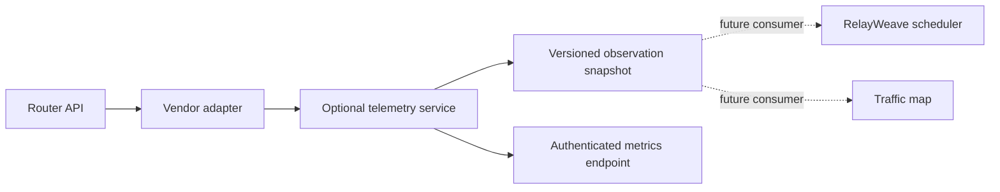

# Optional router telemetry modules

Status: read-only collector and optional worker consumer implemented. Auto and
throughput policies automatically select profiles and ISP weights, with or
without router telemetry. Installing the collector alone does not activate the
consumer. The ordinary RelayWeave stack has no dependency on the collector and
starts without it. No Helm deployment is introduced.

The [automatic routing product contract](automatic-routing-goals.md) takes
precedence: profile selection and weights must be automatic in the normal user
journey. Router telemetry must remain optional and never become a requirement
for good default behavior. The current observe-only module is an input for that
adaptive consumer; full product goals still require the remaining acceptance work.

## Architecture and contract



Use a separate process with a compiled driver registry, rather than Go dynamic
plugins or arbitrary downloadable executable modules. The service owns router
credentials and one persistent TLS session per enabled router. Workers receive
only normalized observations when a consumer is added. Router access is never
on the synchronous connection-selection path. One collector per router avoids
polling fan-out from every worker. CPU, memory and polling budgets are independent
of the worker and control plane.

`Adapter.Read(ctx) -> Reading` and `Adapter.Close()` are the entire vendor-neutral
interface. A registry entry declares driver ID, contract version, capabilities
and a factory. There is no arbitrary command, write, script or network-apply API.
Add a compiled adapter without modifying the worker or the observation model.
The JSON `/v1/snapshot` contract can also be implemented by a future external
adapter service; remote service authentication/version negotiation is not yet
implemented. This is an extension mechanism, not a claim that every router is
already supported.

The first driver is `mikrotik-api-ssl`, with `wan.counters`, `wan.link_state` and
`router.cpu`. Future capabilities can include `wan.queue`, `wan.errors`,
`routing.health` and `routing.egress_evidence`. A driver without a capability
must return unknown/absent observations, never fabricated zeroes. Planned
adapters include OpenWrt ubus, OPNsense/pfSense APIs and authenticated SNMPv3.
These remain unimplemented until device-specific tests establish their semantics.

## Binding and measurement semantics

Configuration maps stable router/WAN IDs to a logical RelayWeave ISP ID and an
explicit router interface. A logical ISP maps to exactly one authoritative WAN
counter in this collector. Mapping both PPPoE and its physical carrier to the
same ISP is rejected to avoid double counting. IDs are operator-defined, not
derived from interface list positions. Maximum: four routers, four WANs each.
Bindings for different worker sites/nodes need an explicit site/worker extension
before use by a multi-node routing consumer; current bindings are global.

WAN RX is household download; WAN TX is household upload. Cumulative byte
counters and sampled bytes/second are distinct fields. A snapshot identifies its
router, driver, capabilities, successful observation time, last attempt time,
state and freshness. Values come from the router's available accounting path;
hardware-offloaded traffic may have different visibility. Ethernet link speed
is not an Internet throughput ceiling. Router bytes and proxy payload bytes
cannot be subtracted as if they were identical measurement layers.

First sample, counter reset, excessive gap or link down yields null rates and an
explicit quality (`baseline`, `counter_reset`, `link_down`). Failed samples clear
live values; stale snapshots never emit live throughput. Failed polls reset the
rate baseline. No last-known-zero speed is substituted for unavailable data.
Default sampling is 2 seconds, timeout 1.8 seconds, stale age 10 seconds. There
is no overlapping poll, packet capture, full conntrack dump or automatic probe
generated by this driver. Polling is bounded independently for each router.

## MikroTik access boundary

Create a dedicated user and **custom** group with exactly `read,api`. Do not use
the built-in `read` group: its defaults include reboot and sensitive privileges.
Do not grant `write`, `policy`, `test`, `sensitive`, `sniff`, `reboot`, `ssh`,
`winbox`, `web`, `rest-api`, `password` or `ftp`. Restrict both user source address
and API-SSL service addresses to the collector host. Use a valid router TLS
certificate and a mounted trusted CA; verify its hostname and validity. TLS 1.2
or later is required. There is no plaintext API or insecure certificate fallback.

RouterOS permissions are coarse: its documentation states that all groups can
access file operations. `read,api` is therefore a configuration-read-only role,
not a universal operating-system read-only sandbox. The adapter independently
allowlists only `/login`, `/system/resource/print`, `/interface/print` and never
exposes a raw API gateway. Credentials must remain private to this service.
RouterOS `api` permission covers both API transports; an existing plaintext API
used by other software cannot be made TLS-only for this one account by group
policy. The module itself always uses API-SSL. Do not change or disable another
integration's API service to hide this limitation.

Passwords and consumer bearer tokens are mounted files, never environment values
or database/API response fields. Config/CA are read-only. Logs contain generic
state/errors rather than protocol rows, login payloads, file contents or router
error messages. Do not publish live config, private CA topology or credentials.
Secrets/config changes take effect on collector restart; rotation is explicit.

Before enabling API-SSL, record its settings and take a protected backup. Check
configuration reads succeed and an idempotent attempt to set the router's
existing identity is rejected for the dedicated user. Never test permissions
by invoking reboot, enabling an interface or altering a real route.

## Deployment and API

The opt-in Compose file is `integrations/router-telemetry/compose.yaml`. The
profile `router-telemetry` is off by default; JSON also defaults both module and
each router to disabled. It runs non-root, read-only, without capabilities or
Docker socket. Default limit: 0.15 CPU, 48 MiB memory; these are budgets, not
measured resource consumption. Linux host networking exposes only loopback
`127.0.0.1:18530` with the same process/host port. Non-loopback listeners are
rejected. No additional public ingress, router port forwarding or Traefik route
is needed.

Some Synology DSM kernels reject Docker CPU quotas. On those systems use
`compose.synology.yaml` instead of this module's Compose file. It replaces the quota
with low relative CPU shares while preserving the memory limit and bounded
polling. CPU shares are not a hard ceiling. Do not change host cgroups or other
containers to make this optional collector start.
DSM can also ignore `pids_limit`; verify engine warnings on the target. That
warning does not imply a PID limit is enforced. The collector still bounds the
number of router loops and wire reads itself.

Copy `config.example.json` into a private directory and replace documentation
addresses. Supply files referenced by `password_file`, `ca_file`, `token_file`.
Use a random consumer token of at least 32 bytes and permissions readable only
by the service identity/administrator. Set global and selected router `enabled`
explicitly. Then:

```sh
export ROUTER_TELEMETRY_CONFIG_DIR=/private/router-telemetry
docker compose -f integrations/router-telemetry/compose.yaml \
  --profile router-telemetry up -d --build
```

Endpoints: unauthenticated `GET /livez` returns process liveness only;
`GET /readyz`, `GET /v1/snapshot`, `GET /metrics` require the consumer bearer
token. Readiness is 503 when enabled telemetry is missing/stale or there is no
enabled router. Liveness remains healthy when the router is unavailable, so a
WAN outage does not create a container restart loop. Mutating HTTP methods are
rejected. Snapshots use `version:1, mode:"observe"`. No settings/write endpoint
exists. Existing monitoring can scrape the authenticated metrics through an
explicitly configured local relay; no embedded Grafana is added. Wiring that
relay and dashboards is separate from the collector deployment.

## Worker routing consumer

Three gates are independent: collector enabled, router enabled, and worker consumer
configured. Merge `compose.worker.yaml` after a Linux host-network worker deployment
and set `ROUTER_TELEMETRY_TOKEN_PATH` to the collector consumer-token file. The
worker receives only that token, never the router password or CA. Its endpoint is
`ROUTER_TELEMETRY_URL=http://127.0.0.1:18530/v1/snapshot`, and
`ROUTER_TELEMETRY_TOKEN_FILE=/router-telemetry/token`. A missing URL disables the
consumer without disabling automatic routing. Invalid config or failed reads
fall back without preventing worker startup. Only literal loopback HTTP URLs,
the snapshot path, bounded responses and no redirects are accepted. No router
command can be issued through this consumer.

Auto/throughput modes derive ISP weights from capacity budgets as priors, the
best eligible profile quality, positive fresh throughput evidence and aggregate
live sessions. Configured `weight` is used by explicit round-robin mode (and
legacy test configurations lacking capacity budgets), not the automatic modes.
Within each ISP, smooth weighted scheduling chooses shared server-IP groups by
inverse observed service cost and aggregate active load, then the best profile
inside the chosen group. Aliases do not sum independent capacity. Existing core,
probe, target-health, revocation and subscription admission filters remain.

Fresh directional WAN rates relative to configured budgets yield a congestion
factor using the larger download/upload utilization. A 5 percentage-point
 deadband, EWMA and 25% maximum per-sample factor change reduce oscillation. The
factor retains a 0.1 floor; router counters do not measure true spare Internet
capacity. Fresh explicit link-down/disabled observations suppress only new
allocations and retries on that ISP. They never kill cores, move established TCP
sessions/UDP associations or enable an operator-disabled path. Link-up alone
never proves Internet/proxy availability.

A background poll every 2 seconds has a 600ms client timeout and a 128KiB body
limit. No HTTP/router/DNS request is made by the selector. A failed fetch,
producer timestamp older than 10 seconds, expired local cache, clock anomaly,
unsupported version or ambiguous/malformed observations remove the advisory
input. Per-ISP smoothing is discarded when data is unavailable; autonomous
quality/load weighting continues immediately. Local timestamps and future-time
bounds prevent a stale producer from appearing fresh after a successful fetch.

Worker `/status` includes `routing_automation.router_telemetry` and timestamped
`last_isp_allocations`. Metrics expose collector freshness and last selection
weights/factors/timestamps. These are last-decision operands, not byte-fairness
or current capacity claims. Traffic-map decision details show automatic ISP/IP
weights, WAN utilization/factor, sample time and autonomous fallback. Existing
configured-weight metrics remain configuration metadata. Separate remote
collector ingress, full router settings UI and dashboards are not added here.

## Acceptance and recovery

On the build host: race/vet, real TLS protocol fixture, certificate hostname
rejection, response bounds/deadlines, no-write allowlist, disabled-no-connect,
rate direction/reset/gap and API auth/staleness tests. Then a disposable Docker
smoke test verifies non-root runtime and loopback listener. Live acceptance must
check verified TLS, minimal account policies, successful bounded readings from
the collector host, harmless write denial, fresh measured WAN rates, secret-free
responses, endpoint auth and no changes to worker/WAN eligibility. Do not put
production router credentials on a shared build host.

Rollback stops only this optional Compose project, revokes its dedicated user,
removes its group after checking membership, and restores recorded API-SSL
settings if nobody else has adopted the service. Keep all existing plain API,
WAN, queue, NAT and worker configuration unchanged. No application database or
runtime rollback is needed when removing only the optional collector/consumer. Reverting the scheduling
implementation also requires restoring the previous worker/control/UI images
and the captured deployment settings.

Sources: [RouterOS API](https://manual.mikrotik.com/docs/developer-guides/api/),
[RouterOS user permissions](https://help.mikrotik.com/docs/spaces/ROS/pages/8978504/User),
[interface accounting](https://manual.mikrotik.com/docs/cli-reference/interface/),
[queue statistics](https://manual.mikrotik.com/docs/firewall-and-quality-of-service/queues/).
