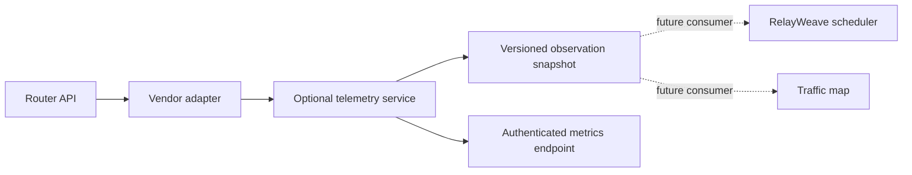

# Опциональные модули телеметрии роутера

[English](router-integrations.md) | **Русский**

Статус: коллектор только для чтения и опциональный потребитель на worker реализованы. Политики auto и throughput автоматически выбирают профили и веса ISP, с телеметрией роутера или без неё. Установка только коллектора не активирует потребителя. Обычный стек RelayWeave не зависит от коллектора и запускается без него. Развёртывание Helm не вводится.

[Контракт продукта автоматической маршрутизации](automatic-routing-goals.ru.md) имеет приоритет: выбор профиля и веса должны быть автоматическими в обычном пользовательском пути. Телеметрия роутера должна оставаться опциональной и никогда не становиться требованием для хорошего поведения по умолчанию. Текущий модуль только наблюдения является входом для этого адаптивного потребителя; полные цели продукта по-прежнему требуют оставшейся приёмочной работы.

## Архитектура и контракт



Используйте отдельный процесс с реестром скомпилированных драйверов, а не динамические плагины Go или произвольные загружаемые исполняемые модули. Сервис владеет учётными данными роутера и одной постоянной TLS-сессией на каждый включённый роутер. Worker получают только нормализованные наблюдения, когда добавляется потребитель. Доступ к роутеру никогда не находится на синхронном пути выбора соединения. Один коллектор на роутер избегает разрастания опросов от каждого worker. Бюджеты CPU, памяти и опросов независимы от worker и control plane.

`Adapter.Read(ctx) -> Reading` и `Adapter.Close()` - это весь независимый от вендора интерфейс. Запись в реестре объявляет ID драйвера, версию контракта, возможности и фабрику. Нет произвольной команды, записи, скрипта или API сетевого применения. Добавляйте скомпилированный адаптер без изменения worker или модели наблюдения. Контракт JSON `/v1/snapshot` также может быть реализован будущим внешним сервисом-адаптером; аутентификация/согласование версий удалённого сервиса пока не реализованы. Это механизм расширения, а не утверждение, что каждый роутер уже поддерживается.

Первый драйвер - `mikrotik-api-ssl`, с `wan.counters`, `wan.link_state` и `router.cpu`. Будущие возможности могут включать `wan.queue`, `wan.errors`, `routing.health` и `routing.egress_evidence`. Драйвер без возможности должен возвращать неизвестные/отсутствующие наблюдения, а не выдуманные нули. Планируемые адаптеры включают OpenWrt ubus, API OPNsense/pfSense и аутентифицированный SNMPv3. Они остаются нереализованными до тех пор, пока тесты для конкретных устройств не установят их семантику.

## Привязка и семантика измерений

Конфигурация сопоставляет стабильные ID роутера/WAN с логическим ID ISP RelayWeave и явным интерфейсом роутера. Логический ISP сопоставляется ровно с одним авторитетным счётчиком WAN в этом коллекторе. Сопоставление одновременно PPPoE и его физического носителя с одним ISP отклоняется во избежание двойного подсчёта. ID определяются оператором, а не выводятся из позиций списка интерфейсов. Максимум: четыре роутера, по четыре WAN каждый. Привязки для разных площадок/узлов worker требуют явного расширения site/worker перед использованием многоузловым потребителем маршрутизации; текущие привязки глобальны.

WAN RX - это загрузка домашней сети; WAN TX - выгрузка домашней сети. Кумулятивные счётчики байтов и измеренные байты/с являются разными полями. Снимок идентифицирует свой роутер, драйвер, возможности, время успешного наблюдения, время последней попытки, состояние и свежесть. Значения поступают из доступного пути учёта роутера; трафик с аппаратным offload может иметь другую видимость. Скорость Ethernet-канала не является потолком пропускной способности Интернета. Байты роутера и байты полезной нагрузки прокси нельзя вычитать так, будто это идентичные слои измерений.

Первый образец, сброс счётчика, чрезмерный разрыв или link down дают null-скорости и явное качество (`baseline`, `counter_reset`, `link_down`). Неудачные образцы очищают живые значения; устаревшие снимки никогда не выдают живую пропускную способность. Неудачные опросы сбрасывают базовую линию скорости. Никакая последняя известная нулевая скорость не подставляется вместо недоступных данных. Выборка по умолчанию - 2 секунды, тайм-аут - 1,8 секунды, возраст устаревания - 10 секунд. Этот драйвер не создаёт перекрывающийся опрос, захват пакетов, полный дамп conntrack или автоматическую пробу. Опрос ограничен независимо для каждого роутера.

## Граница доступа MikroTik

Создайте выделенного пользователя и **пользовательскую** группу ровно с `read,api`. Не используйте встроенную группу `read`: её значения по умолчанию включают перезагрузку и конфиденциальные привилегии. Не предоставляйте `write`, `policy`, `test`, `sensitive`, `sniff`, `reboot`, `ssh`, `winbox`, `web`, `rest-api`, `password` или `ftp`. Ограничьте как исходный адрес пользователя, так и адреса службы API-SSL адресом хоста коллектора. Используйте действительный TLS-сертификат роутера и смонтированный доверенный CA; проверяйте его имя хоста и срок действия. Требуется TLS 1.2 или более поздняя версия. Нет API в открытом виде и небезопасного запасного варианта сертификата.

Разрешения RouterOS грубы: в его документации указано, что все группы могут обращаться к файловым операциям. Поэтому `read,api` - это роль только для чтения конфигурации, а не универсальная песочница операционной системы только для чтения. Адаптер независимо включает в allowlist только `/login`, `/system/resource/print`, `/interface/print` и никогда не предоставляет необработанный шлюз API. Учётные данные должны оставаться приватными для этого сервиса. Разрешение RouterOS `api` охватывает оба транспорта API; существующий открытый API, используемый другим программным обеспечением, нельзя сделать доступным только по TLS для этой одной учётной записи политикой группы. Сам модуль всегда использует API-SSL. Не изменяйте и не отключайте службу API другого интеграционного решения, чтобы скрыть это ограничение.

Пароли и bearer-токены потребителя - это смонтированные файлы, никогда не значения окружения или поля ответа базы данных/API. Конфигурация/CA доступны только для чтения. Журналы содержат общие состояния/ошибки, а не строки протокола, полезные нагрузки входа, содержимое файлов или сообщения об ошибках роутера. Не публикуйте живую конфигурацию, приватную топологию CA или учётные данные. Изменения секретов/конфигурации вступают в силу при перезапуске коллектора; ротация выполняется явно.

Перед включением API-SSL запишите его настройки и сделайте защищённую резервную копию. Проверьте, что чтение конфигурации успешно, а идемпотентная попытка установить существующую идентичность роутера отклоняется для выделенного пользователя. Никогда не проверяйте разрешения путём перезагрузки, включения интерфейса или изменения реального маршрута.

## Развёртывание и API

Опциональный Compose-файл - `integrations/router-telemetry/compose.yaml`. Профиль `router-telemetry` по умолчанию отключён; JSON также по умолчанию отключает как модуль, так и каждый роутер. Он работает не от root, в режиме только для чтения, без возможностей и без Docker-сокета. Лимит по умолчанию: 0,15 CPU, 48 MiB памяти; это бюджеты, а не измеренное потребление ресурсов. Сетевое взаимодействие хоста Linux предоставляет только loopback `127.0.0.1:18530` с тем же портом процесса/хоста. Слушатели не на loopback отклоняются. Дополнительный публичный вход, перенаправление портов роутера или маршрут Traefik не нужны.

Некоторые ядра Synology DSM отклоняют квоты CPU Docker. В таких системах используйте `compose.synology.yaml` вместо Compose-файла этого модуля. Он заменяет квоту низкими относительными долями CPU, сохраняя лимит памяти и ограниченный опрос. Доли CPU не являются жёстким потолком. Не изменяйте cgroups хоста или другие контейнеры, чтобы этот опциональный коллектор запустился. DSM также может игнорировать `pids_limit`; проверьте предупреждения движка на целевой системе. Это предупреждение не означает, что лимит PID применяется. Коллектор по-прежнему сам ограничивает число циклов роутера и сетевых чтений.

Скопируйте `config.example.json` в приватный каталог и замените адреса из документации. Предоставьте файлы, на которые ссылаются `password_file`, `ca_file`, `token_file`. Используйте случайный токен потребителя не менее 32 байт и права, доступные только идентичности сервиса/администратору. Явно задайте `enabled` глобально и для выбранного роутера. Затем:

```sh
export ROUTER_TELEMETRY_CONFIG_DIR=/private/router-telemetry
docker compose -f integrations/router-telemetry/compose.yaml \
  --profile router-telemetry up -d --build
```

Эндпоинты: неаутентифицированный `GET /livez` возвращает только живость процесса; `GET /readyz`, `GET /v1/snapshot`, `GET /metrics` требуют bearer-токен потребителя. Готовность - 503, когда включённая телеметрия отсутствует/устарела или нет включённого роутера. Живость остаётся здоровой, когда роутер недоступен, поэтому сбой WAN не создаёт цикл перезапуска контейнера. Изменяющие HTTP-методы отклоняются. Снимки используют `version:1, mode:"observe"`. Эндпоинт настроек/записи отсутствует. Существующий мониторинг может собирать аутентифицированные метрики через явно настроенный локальный ретранслятор; встроенная Grafana не добавляется. Подключение этого ретранслятора и дашбордов отделено от развёртывания коллектора.

## Потребитель маршрутизации на worker

Три условия независимы: коллектор включён, роутер включён и потребитель на worker настроен. Объедините `compose.worker.yaml` после развёртывания worker с сетью хоста Linux и задайте `ROUTER_TELEMETRY_TOKEN_PATH` как файл токена потребителя коллектора. Worker получает только этот токен, никогда не пароль роутера или CA. Его эндпоинт - `ROUTER_TELEMETRY_URL=http://127.0.0.1:18530/v1/snapshot`, а `ROUTER_TELEMETRY_TOKEN_FILE=/router-telemetry/token`. Отсутствующий URL отключает потребителя, не отключая автоматическую маршрутизацию. Неверная конфигурация или неудачные чтения приводят к запасному варианту без предотвращения запуска worker. Принимаются только буквальные loopback HTTP URL, путь снимка, ограниченные ответы и без перенаправлений. Через этого потребителя нельзя выдать ни одной команды роутеру.

Режимы auto/throughput выводят веса ISP из бюджетов ёмкости как априорных значений, лучшего качества подходящего профиля, положительных свежих данных о пропускной способности и совокупных живых сессий. Настроенный `weight` используется явным режимом round-robin (и устаревшими тестовыми конфигурациями без бюджетов ёмкости), а не автоматическими режимами. Внутри каждого ISP плавное взвешенное планирование выбирает общие группы серверных IP по обратной наблюдаемой стоимости обслуживания и совокупной активной нагрузке, затем лучший профиль внутри выбранной группы. Псевдонимы не суммируют независимую ёмкость. Существующие фильтры допуска core, probe, target-health, отзыва и подписки сохраняются.

Свежие направленные скорости WAN относительно настроенных бюджетов дают коэффициент перегрузки с использованием большей утилизации загрузки/выгрузки. Мёртвая зона в 5 процентных пунктов, EWMA и максимальное изменение коэффициента на 25% за образец уменьшают колебания. Коэффициент сохраняет нижнюю границу 0.1; счётчики роутера не измеряют истинную свободную пропускную способность Интернета. Свежие явные наблюдения link-down/disabled подавляют только новые выделения и повторы на этом ISP. Они никогда не убивают core, не перемещают установленные TCP-сессии/UDP-ассоциации и не включают путь, отключённый оператором. Только link-up никогда не доказывает доступность Интернета/прокси.

Фоновый опрос каждые 2 секунды имеет клиентский тайм-аут 600 мс и лимит тела 128 KiB. Селектор не делает HTTP/router/DNS-запросов. Неудачная выборка, метка времени производителя старше 10 секунд, истёкший локальный кеш, аномалия часов, неподдерживаемая версия или неоднозначные/некорректные наблюдения удаляют вспомогательный вход. Сглаживание по каждому ISP отбрасывается, когда данные недоступны; автономное взвешивание по качеству/нагрузке продолжается немедленно. Локальные метки времени и границы будущего времени не позволяют устаревшему производителю выглядеть свежим после успешной выборки.

`/status` worker включает `routing_automation.router_telemetry` и `last_isp_allocations` с метками времени. Метрики предоставляют свежесть коллектора и веса/коэффициенты/метки времени последнего выбора. Это операнды последнего решения, а не утверждения о байтовой справедливости или текущей ёмкости. Детали решений карты трафика показывают автоматические веса ISP/IP, утилизацию/коэффициент WAN, время образца и автономный запасной вариант. Существующие метрики настроенных весов остаются метаданными конфигурации. Отдельный вход удалённого коллектора, полный UI настроек роутера и дашборды здесь не добавляются.

## Приёмка и восстановление

На сборочном хосте: race/vet, фикстура реального протокола TLS, отклонение имени хоста сертификата, границы/крайние сроки ответа, allowlist без записи, disabled-no-connect, направление скорости/сброс/разрыв и тесты аутентификации/устаревания API. Затем одноразовый smoke-тест Docker проверяет работу не от root и loopback-слушатель. Живая приёмка должна проверить подтверждённый TLS, минимальные политики учётной записи, успешные ограниченные чтения с хоста коллектора, безвредный отказ записи, свежие измеренные скорости WAN, ответы без секретов, аутентификацию эндпоинта и отсутствие изменений пригодности worker/WAN. Не размещайте производственные учётные данные роутера на общем сборочном хосте.

Откат останавливает только этот опциональный Compose-проект, отзывает его выделенного пользователя, удаляет его группу после проверки членства и восстанавливает записанные настройки API-SSL, если никто другой не принял службу. Сохраняйте всю существующую конфигурацию открытого API, WAN, очередей, NAT и worker без изменений. При удалении только опционального коллектора/потребителя откат базы данных приложения или среды выполнения не требуется. Откат реализации планирования также требует восстановления предыдущих образов worker/control/UI и зафиксированных настроек развёртывания.

Источники: [RouterOS API](https://manual.mikrotik.com/docs/developer-guides/api/),
[разрешения пользователя RouterOS](https://help.mikrotik.com/docs/spaces/ROS/pages/8978504/User),
[учёт интерфейсов](https://manual.mikrotik.com/docs/cli-reference/interface/),
[статистика очередей](https://manual.mikrotik.com/docs/firewall-and-quality-of-service/queues/).
